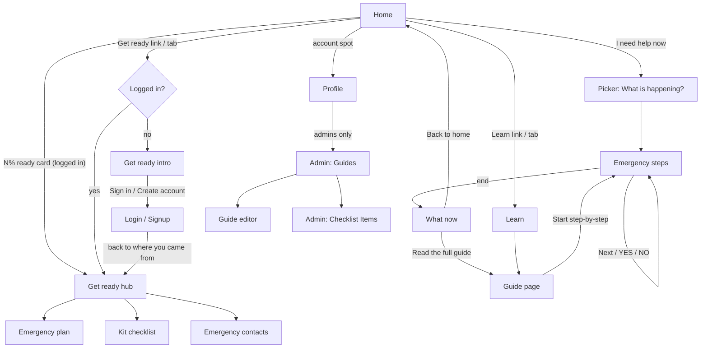

# SafeSteps: Screens & Flow

Every screen in SafeSteps: who can open it, who owns it, how you get in and out, and what it shows. Read it together with `docs/PLAN.md` (models, API, timeline), [Style sheet v1](design/Style%20sheet%20v1.pdf) (all visual values), the [Choking flow mockup](design/SafeSteps%20%E2%80%94%20Choking%20flow.pdf) and `GLOSSARY.md` (the words we use).

Decisions were made in the three screen-flow issues: Person 1 (#1), Person 2 (#11), Person 3 (#12).

---

## 1. Shared rules

- **Mobile website** used in the phone's browser. There is no install screen. Guides are saved for offline use automatically.
- **Two layouts.** *Panic* is for Emergency Mode only: huge text, one action, no tab bar. *Calm* is for everything else. **Red means Call 1122 and nothing else.** Warnings, "Don't" advice and form errors use warning amber with a "!".
- **Call 1122 bar:** red, full width, fixed to the bottom of every user-facing screen (above the tab bar on Calm screens), including Login and Profile. One tap dials `tel:1122`, no menu. **Not shown on admin pages.**
- **Calm header:** "SafeSteps" on the left; on the right, the offline chip and the account spot ("Sign in" or the user's name).
- **Tab bar (Calm, phone):** Home · Learn · Get ready. **Desktop:** the tabs move into the header as links; content sits in a centred column of about 720px; Emergency Mode stays a phone-width column in the centre; the Call 1122 bar stays at the bottom.
- **Login:** only Get ready and Profile need it. Learn, Guide and Emergency Mode never do.
- **Words:** users see "Get ready" and "I need help now"; code says `prepare` and `emergency`.

### Shared states (Person 1 builds them; each screen's owner writes the wording)

| State | Looks like |
|---|---|
| Loading | Grey placeholder blocks shaped like the content |
| Empty | One friendly line plus the action ("No contacts yet. Add a person") |
| Error | Warning-amber box with "!" and **Try again** |
| Offline | Offline chip ("Guides saved on this phone") plus whatever is saved on the phone. Editing is switched off. |

**Offline chip honesty.** Show "Guides saved on this phone" only after checking that the guides really are saved. If nothing is saved yet: "Guides not saved yet. Connect once to save them." iPhone Safari deletes saved site data after 7 days without a visit, and clearing browser data wipes it everywhere, so add a short "can be cleared" note. See the research doc on the `research/pwa-install-offline` branch.

---

## 2. Flow

The Call 1122 bar is on every user-facing screen, so it isn't drawn.

---

## 3. Screen inventory

| # | Screen | Route | Layout | Access | Owner (build + design) |
|---|---|---|---|---|---|
| 1 | Home | `/` | Calm | Public | P1 |
| 2 | Picker | `/emergency` | Panic | Public | P1 |
| 3 | Emergency steps | `/emergency/:slug` | Panic | Public | P1 |
| 4 | What now | `/emergency/:slug/done` | Calm | Public | P1 |
| 5 | Learn | `/learn` | Calm | Public | P2 |
| 6 | Guide page | `/guides/:slug` | Calm | Public | P2 |
| 7 | Get ready hub | `/prepare` | Calm | User (logged out → intro) | P1 |
| 8 | Get ready intro | any `/prepare*` while logged out | Calm | Public | P1 |
| 9 | Emergency plan | `/prepare/plan` | Calm | User | P1 |
| 10 | Kit checklist | `/prepare/checklist` | Calm | User | P1 |
| 11 | Emergency contacts | `/prepare/contacts` | Calm | User | P1 |
| 12 | Login | `/login` | Calm | Public | P3 |
| 13 | Signup | `/signup` | Calm | Public | P3 |
| 14 | Profile | `/profile` | Calm | User | P3 |
| 15 | Admin: Guides | `/admin` | Admin (desktop) | Admin | P2 |
| 16 | Guide editor | `/admin/guides/new`, `/admin/guides/:id/edit` | Admin (desktop) | Admin | P2 |
| 17 | Admin: Checklist Items | `/admin/checklist` | Admin (desktop) | Admin | P1 |
| 18 | No access | any `/admin*` for a non-admin | Calm | User | P3 |

Screens 1–6, 12–13, 15 and the hub (7) are covered by the 7 wireframes. Owners design the rest from the style sheet, and **Person 1 does the final consistency pass**.

---

## 4. Screens

### 1. Home (P1)
- A large **"I need help now"** card that opens the Picker.
- Small **Learn** and **Get ready** links under it.
- **Logged in only:** a small "You're N% ready" card below the links, which opens the Get ready hub.
- Nothing else. Header, tab bar and Call 1122 bar as usual.

### 2. Picker: "What is happening?" (P1)
- All 8 **published** guides as 2-per-row picture tiles with everyday **picker labels**, medical first: Someone is choking · Bad bleeding · A burn · Someone fainted · Earthquake · Fire · Heavy rain / flood · Extreme heat.
- Tapping a tile starts that flow. The back arrow goes to Home. No tab bar.

### 3. Emergency steps (P1)
- One step per screen. Each step is either:
  - an **instruction**: picture panel, at most 8 words, **Next**, or
  - a **yes/no question**: picture panel, question, **YES** / **NO**. Each answer jumps to a chosen step (including an earlier one, for repeats such as "Is it still stuck?") or to the end.
- Only these elements are allowed: back arrow, progress dots, picture, one main action, Call 1122 bar.
- The **back arrow** retraces the path actually taken. From the first step it returns to wherever the flow started (Picker or Guide page).
- **Progress dots** show the step's position in the flow as written. They don't count the path taken.
- After the person taps Call 1122 and comes back to the browser, they are on the same step.

### 4. What now (P1)
- One line of after-care ("Stay with them until help arrives").
- **The other emergency numbers first:** 15 Police, 16 Fire, 115 Edhi (from `emergencyNumbers.js`).
- **Saved contacts** if logged in, with "first" at the top. They work offline from the read-only copy kept on the phone. Logged out: only a small "Sign in to add your contacts" link.
- **Read the full guide** (goes to the Guide page) and **Back to home**.

### 5. Learn (P2)
- One screen with two labelled sections, **Medical** then **Disasters**, 4 guides each. There is no categories screen and there are no filter chips.
- Each guide is a style-sheet **card**: picture, guide title, one-line summary.

### 6. Guide page (P2)
- Title, then a **Start step-by-step** button that opens this guide's Emergency Mode flow directly.
- **One long scrolling page.** A sticky jump bar of chips jumps to each section and highlights the one you're reading.
  - Medical: **Signs · What to do · Don't · When to call 1122**
  - Disasters: **Before · During · After · Don't**
- **Don't** items appear in warning amber with "!".

### 7. Get ready hub (P1)
- **Preparedness %** at the top: ticked published items ÷ all published items.
- Three cards, each with a one-line status: **Emergency plan** · **Kit checklist** ("12 of 20 packed") · **Emergency contacts** ("2 contacts").

### 8. Get ready intro (P1)
- Shown instead of the hub (or any Get ready screen) when logged out. There is no redirect.
- One line on what Get ready is, plus **Sign in** and **Create account**.

### 9. Emergency plan (P1)
- **Meeting points** (a list you can add to) and **notes**. Contacts are not part of the plan; they live only on the Contacts screen.

### 10. Kit checklist (P1)
- Items **grouped by category** (water, food, medical, documents…), as style-sheet checkbox rows where the whole row is tappable.
- The % updates as soon as you tick something.

### 11. Emergency contacts (P1)
- Exactly as in the mockup: the contacts list (with **Edit** on each person), and the **Add a person** form below it on the same screen (Name, Phone, "Put this person first", Save). Edit fills the same form.

**Get ready while offline (9–11):** the last loaded data is shown read-only with the offline chip. Save, Add and ticking are switched off.

### 12–13. Login / Signup (P3)
- **Signup:** name, email, password (at least 8 characters). **Login:** email, password. Each links to the other.
- Errors appear under the field in warning amber with "!".
- **After login or signup:** back to the screen you came from, or Home if you came straight to `/login`. **After logout:** Home.

### 14. Profile (P3)
- Opened from the header's account spot.
- Editable name, read-only email, change password, **Log out**, and **Delete account** (with a confirm step warning that your Get ready data is deleted too).
- **Admins only:** an **Admin dashboard** link.

### 15. Admin: Guides (P2)
- Admin header: "Signed in as [name] · Sign out" and **Back to SafeSteps** (goes to Home). No Call 1122 bar.
- Sidebar: **Guides · Checklist Items**, nothing else.
- Guide table (search, "Show drafts" toggle), each guide marked **Draft** or **Published**, plus **New guide**. It becomes a stacked list at phone width.

### 16. Guide editor (P2)
- One long form:
  - **Basics:** title, picker label, summary, category. The category decides which section format appears.
  - **Sections:** each one a list of bullet items.
  - **Emergency Mode steps:** an ordered list. Each step has a type, text and an optional picture; questions also have **YES →** / **NO →** dropdowns (a step number or "End").
- **Save as draft** / **Publish**. You can unpublish a guide but not delete it.

### 17. Admin: Checklist Items (P1)
- Items grouped by category. Each row has the name, a Draft / Published toggle and Edit. An **Add item** form at the bottom (name, category, Save).
- You can unpublish an item but not delete it.

### 18. No access (P3)
- Shown to a logged-in non-admin who opens `/admin*`: "You don't have access", with a Home link. (Logged-out visitors go to Login first and come back.)

---

## 5. Not doing

- An install prompt or install screen.
- A Settings screen. "Save guides offline" is automatic, and "Big text" is left to the phone's own text size and zoom.
- Admin sections for Emergency numbers, Pictures, Offline packs and Settings, and a "Needs review" status.
- Deleting guides or checklist items.
- Everything in PLAN.md §1 "Out of scope".
